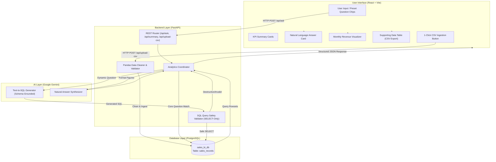

# Architecture & System Design

## 1. Overview
The **AI Business Intelligence Assistant** is a modular, full-stack application designed to allow business users to ask natural language questions regarding sales performance and receive verified answers backed by database execution.

The architecture emphasizes **precision, deterministic execution, and security**, employing a **Vectorless RAG (Retrieval-Augmented Generation)** strategy for structured relational data.

---

## 2. Architecture Diagram

---

## 3. The "Vectorless RAG" Architecture for Tabular Data

### Why Not Traditional Vector RAG?
Traditional Vector RAG chunks rows into text, converts them into embeddings, and performs cosine similarity search. While effective for unstructured text (PDFs, docs), **vector search fails for business intelligence**:
- It cannot perform mathematical aggregations (`SUM`, `AVG`, `COUNT`, `GROUP BY`).
- It hallucinates numbers because similarity search retrieves a sample of rows rather than scanning all records.

### How Vectorless RAG Works Here:
1. **Dynamic Metadata Grounding**: The LLM is provided with exact relational table definitions, column types, constraints, and standard business logic (e.g., `status = 'Completed'`).
2. **Deterministic Translation**: The LLM translates user intent into standard SQL algebra.
3. **AST & Token Safety Validation**: The generated SQL is intercepted and audited by the safety validator before reaching the database.
4. **Execution on Relational Engine**: The database computes exact arithmetic deterministically.
5. **Answer Grounding**: The resulting rowset is passed back to the LLM solely to synthesize a human-friendly sentence, ensuring zero mathematical hallucination.

---

## 4. Component Breakdown

### 4.1 Frontend (`frontend/`)
- **React (Vite)**: Clean, component-based single-page application.
- **Components**:
  - `Header.jsx`: Title, branding, and 1-click CSV upload button.
  - `KpiCards.jsx`: Real-time KPI summaries (Total Revenue, Orders, Top Product, Top Region).
  - `SamplePills.jsx`: 1-click triggers for the 5 assignment questions.
  - `SearchBox.jsx`: Natural language query input with keyboard shortcut support.
  - `AnswerCard.jsx`: Direct business answer, latency telemetry, engine badge, and proactive follow-ups.
  - `TrendChart.jsx`: Visual bar chart rendered for monthly trend queries.
  - `DataTable.jsx`: Formatted table showing supporting database records with CSV export.

### 4.2 Backend (`backend/app/`)
- **FastAPI**: Asynchronous web framework with automatic OpenAPI documentation.
- **Modules**:
  - `config.py`: Environment configuration and secrets management.
  - `database.py`: SQLAlchemy engine and connection pooling.
  - `models.py`: Declarative ORM model mapping `sales_records`.
  - `schemas.py`: Pydantic validation schemas.
  - `data_cleaner.py`: Pandas pipeline handling missing values, bad quantities, and date conversions.
  - `query_validator.py`: Strict SQL security validator (SELECT-only whitelist).
  - `ai_service.py`: Gemini client for text-to-SQL and natural summary generation.
  - `analytics_service.py`: Orchestrator balancing deterministic query handlers with AI fallback.

### 4.3 Database (`PostgreSQL 16`)
- Relational storage running on port `5433` with database `sales_bi_db`.
- Indexed columns on `transaction_id`, `order_date`, `product`, `region`, and `status`.

---

## 5. Security & Guardrail Model

To prevent destructive database operations and SQL injection:
1. **Keyword Blacklist**: Rejects any statement containing `DROP`, `DELETE`, `UPDATE`, `INSERT`, `ALTER`, `TRUNCATE`, `EXEC`, `SHUTDOWN`, or system table identifiers (`information_schema`).
2. **Statement Boundary Check**: Prevents multi-statement attacks by rejecting queries containing internal semicolons.
3. **Table Whitelist**: Enforces that queries strictly reference the allowed table (`sales_records`).
4. **Read-Only Enactment**: All dynamic executions only accept statements beginning with `SELECT` or `WITH`.
5. **Database User Isolation**: Database connection privileges are restricted to the application database.
